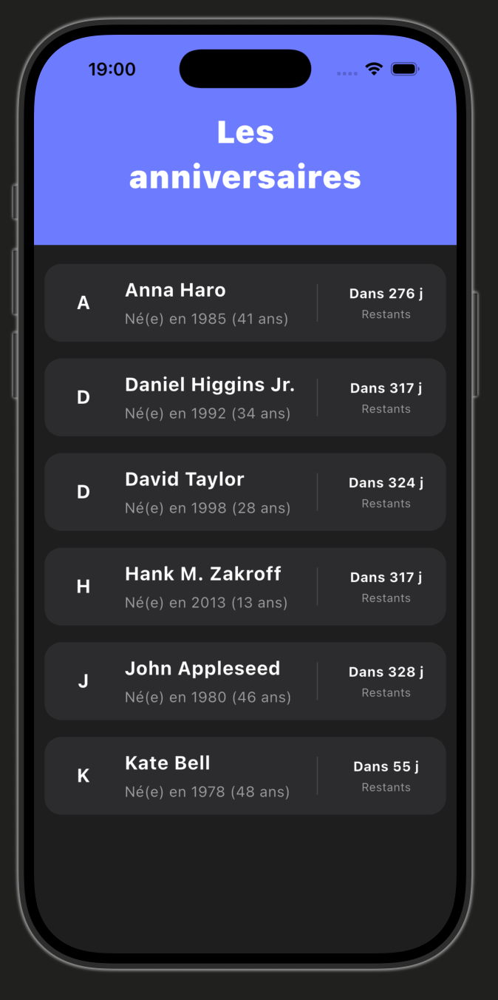
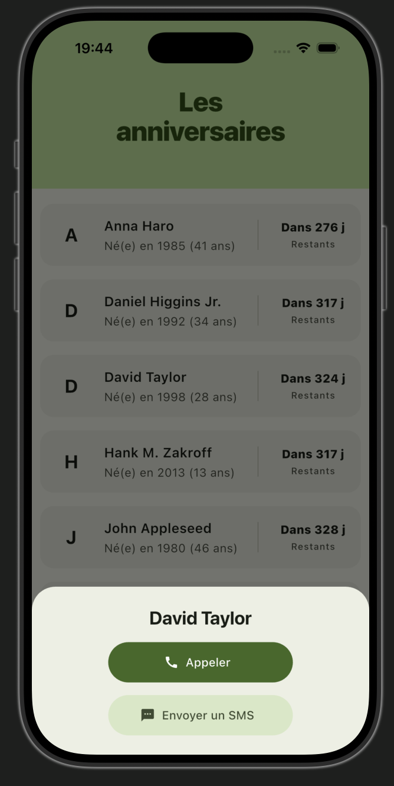
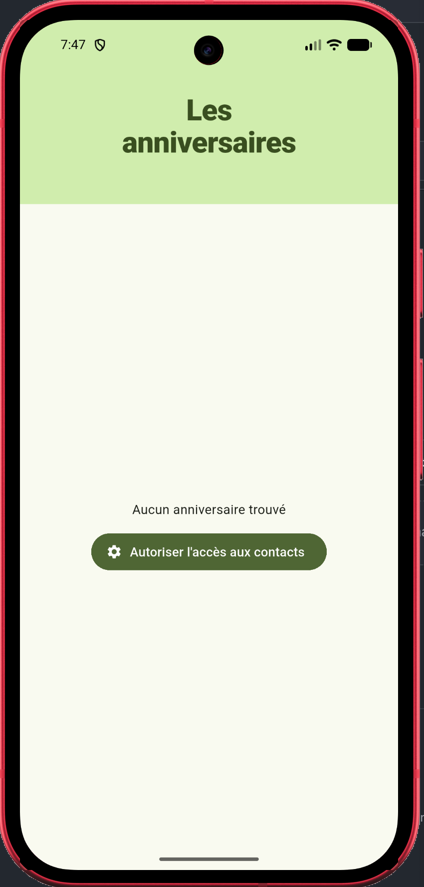
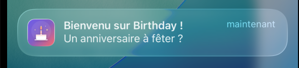

# Birthday

C'est une application pour récupérer les contacts de votre téléphone qui ont une date d'anniversaire, ça permet également de savoir combien de jours il reste avant leur d'anniversaire.

<p>
  
  
</p>
<p>
  
</p>
<p>
  
</p>

<br>

# Fonctionnalités

Importation des contacts du téléphone avec affichage nom, prénom, date de naissance, numéro de téléphone, photo.

Bouton pour envoyer un SMS ou appeler

Bouton qui redirige vers les réglages de l'application pour modifier l'accès aux contacts :

- Aucun
- Accès limité
- Accès complet (les contacts avec une date d'anniversaire seulement)

Notification de bienvenue lors du démarrage de l'application

<br>

# Installation

## Prérequis

- Flutter 3.47.4 (stable) / Dart 3.13.3
- Un Android
- Un iPhone

<br> 
À la racine du projet faire :

- `fvm install`
- `fvm flutter pub get`
- `fvm flutter run`

## Android (APK)

- Télécharger le fichier `app-release.apk` depuis la page [Releases](https://github.com/FarCodeFR/Birthday/releases) du dépôt.

- Sur Android, ouvrir le fichier et autoriser l'installation d'applications inconnues si Android le demande.

- Au premier lancement, accepter l'accès aux contacts et aux notifications.

- Pour générer l'APK soi-même :
  `fvm flutter build apk --release`
  (fichier dans `build/app/outputs/flutter-apk/`).

## iOS

- Pas de fichier installable : la distribution iOS (TestFlight / `.ipa`) nécessite un compte Apple Developer payant.

- Lancer depuis un Mac avec Xcode : brancher l'iPhone (ou ouvrir le simulateur) puis `fvm flutter run`.

- Au premier lancement, accepter l'accès aux contacts et aux notifications.

<br>

# Choix Techniques

- Flutter : une seule base de code pour Android et iOS.

- FVM : fige la version de Flutter (3.47.4) pour que le projet se lance pareil sur toutes les machines.

- Architecture par feature (data / domain / presentation) : chaque couche a un rôle (récupérer, décrire, afficher).

- Repository (`BirthdayRepository` + `BirthdayRepositoryImpl`) l'UI dépend d'une interface et pas de flutter_contacts directement. On peut changer la source de données (API, fausses données pour les tests) sans modifier l'interface.

- flutter_contacts : accès aux contacts Android et iOS.

- permission_handler : demande et vérifie les permissions, et ouvre les réglages de l'app si l'accès est refusé.

- url_launcher : appel et SMS via les applications natives du téléphone (`tel:` / `sms:`).

- flutter_local_notifications : notifications locales, sans serveur ni Firebase.

- timezone + flutter_timezone : programmer les notifications à l'heure locale du téléphone.

- google_fonts : polices personnalisées sans les intégrer à la main.

<br>

# Architecture

Le projet suit une architecture par feature, découpée en couches :

```
lib/
├── main.dart                     # Point d'entrée : init Flutter, notifications, runApp
├── app.dart                      # MaterialApp : thèmes clair / sombre, page d'accueil
└── features/birthdays/
    ├── data/
    │   ├── data_sources/         # Récupère les contacts du téléphone (flutter_contacts)
    │   ├── models/               # Convertit les contacts bruts en données de l'app
    │   └── repositories/         # Implémentation du repository
    ├── domain/
    │   ├── entities/             # Type Birthday + calcul du prochain anniversaire
    │   └── repositories/         # Interface du repository
    ├── presentation/
    │   ├── pages/                # HomePage (FutureBuilder + liste)
    │   ├── widgets/              # BirthdayCard + bottom sheet appel / SMS
    │   └── birthday_text.dart    # Textes selon les jours restants
    └── notifications/            # Init et envoi des notifications locales
```

Flux des données : data source → model → repository → entity → UI.

<br>

# Difficultés et améliorations

Difficulté avec le language Dart + finir la fonctionnalité sur les notifications

- Ajouter une notification avec rappel 7j 3j 1j pour les anniversaires.

- L'ajout de tests
